# Roof Geometry from Aerial Orthophotos under Airborne LiDAR Supervision

**Oluwatifunmilayo Ude** · funmichimdi@gmail.com

November 2026 · code: [github.com/FunmilayoUde/roof-from-aerial-photo](https://github.com/FunmilayoUde/roof-from-aerial-photo) · LiDAR teacher (`roofrecon`): [github.com/FunmilayoUde/roof-measurement-from-lidar](https://github.com/FunmilayoUde/roof-measurement-from-lidar)

---

## Abstract

Airborne LiDAR measures roof geometry well but covers a small part of the world. Aerial imagery
covers almost all of it. We study whether a convolutional network can learn to measure roofs from
8 cm orthophotos when its only supervision is the output of a LiDAR roof-reconstruction pipeline,
with no manual annotation. Three problems stand between the LiDAR measurements and usable image
labels, and we address each one. Relief displacement shifts roofs by 0.2–0.8 m (10th–90th percentile) relative to the
LiDAR; we establish this with a ground-level test and correct it per house with a one-parameter
relief model, fitted by edge registration. Registration turns out to depend on the JPEG encoding
of each image request, so we register every house on two renderings and keep only houses whose
shift repeats. The LiDAR pipeline itself degrades at lower point density; we rescale its
neighbourhood radii to the measured point spacing. A U-Net trained on the resulting 351 houses
predicts roof extent, pitch and facing direction per pixel. Under spatially blocked
cross-validation in Bilthoven (NL), it estimates roof surface area with a median absolute error
of 8.9% against the LiDAR measurement, compared with 11.5% for the standard footprint-times-factor
method (paired difference −2.5 points, 95% CI −4.1 to −0.3, or −3.8 to −0.3 when
resampling 250 m spatial blocks; closer on 204 of 351 houses, two-sided sign test p = 0.003).
The largest gain is on flat roofs. Roof edges typed by geometric rules from the predicted
orientation reach 0.53 precision and 0.43 recall within 24 cm; the same rules applied to the
LiDAR labels reach 0.84–0.98 precision for every type except breaks, so the predictions,
not the rules, limit edge quality. Applied without retraining to a second
town, the model keeps its segmentation and orientation quality but reads pitch about 7° lower than on
equally steep roofs in Bilthoven (mean bias −8.5° per facet), which biases area by −10.7%. Adding the second town's houses to training removes the offset
(8.0% area error there, 8.1% in Bilthoven). We report the negative results and the conclusions we
withdrew along the way, which in several cases changed the method more than the positive ones.

---

## 1. Introduction

Roofing contractors, insurers and solar installers need per-roof measurements: the surface area
of each plane, its pitch, and the type and length of each edge (ridge, hip, valley, eave, rake).
Airborne LiDAR delivers these directly, because each roof plane is sampled in three dimensions.
The Netherlands has national LiDAR coverage at 10–20 points/m² (AHN), but most countries have
none, and where it exists it is often years old. Aerial and satellite imagery, by contrast, is
nearly universal and refreshed often.

The question we ask is narrow: *if a model is trained where LiDAR exists, how much of the roof
geometry can it recover from imagery alone, and does that ability survive a move to another
place?* The setting is a form of cross-modal distillation. A deterministic LiDAR pipeline acts as
a teacher, producing labels at no annotation cost; an image model is the student. The appeal is
scale: AHN alone covers several million buildings. The difficulty is that the teacher's labels
are not image labels. They live in a different geometry (3-D points versus a projected,
mosaicked photograph), they have systematic errors of their own, and they are only as good as
the teacher's behaviour on data it was not tuned for.

We make the following contributions.

1. **A label-transfer procedure from LiDAR roof models to orthophotos** that corrects relief
   displacement per house with a one-parameter model, detects encoding-dependent registration
   failures by registering twice, and filters houses with six quality gates (§4). We show with a
   ground-level test that the misalignment is relief displacement, not georeferencing error.
2. **A density adaptation of the teacher.** A pipeline tuned at 25–50 points/m² fragments roof
   planes at 15 points/m²; scaling its radii to the measured point spacing raises plane coverage
   from 0.53 to 0.96 without changing its output at the original density (§4.2).
3. **A spatially blocked evaluation** of a photo-only area estimator against the standard
   non-imaging estimate, building footprint × a fitted factor (§6), with ensembles, cross-fold
   calibration, paired statistics and a spatial block bootstrap (§7). The model wins
   by 2.5 points overall and by 24 points on mostly flat roofs.
4. **A transfer study** showing which outputs carry to a new town and which do not: extent and
   orientation transfer; pitch, and through it area, does not, until the new town is in training
   (§7.6).
5. **An account of the failures**: a first model that lost to the baseline, an augmentation
   hypothesis that dissolved under seed variance, and three edge-detection variants that did not
   beat simple rules (§7, Appendix B).

---

## 2. Related work

**Building and roof extraction from imagery.** Pixel-wise building segmentation from aerial
images is a mature problem [9–11]. The Inria benchmark [9] was designed specifically to test
whether models trained in some cities generalise to others, and found substantial drops, which
motivates our transfer experiment. Kaiser et al. [29] trained on building outlines from
OpenStreetMap, accepting label noise in exchange for scale; our labels are noisier in different
ways (they come from a reconstruction, not a map) but similarly free.

**Roof structure from imagery.** DeepRoof [12] estimates roof planes and their orientation from
satellite imagery for solar potential, the closest application to ours. Structured
reconstruction methods recover the planar graph of a roof (corners and edges) directly:
Conv-MPN [14], the primitive-detection approach of Nauata and Furukawa [13], and HEAT [15]. These
are trained on manually annotated roof graphs. We predict dense per-pixel quantities instead and
derive edges geometrically, a simpler pipeline that lets us measure separately how much error
comes from the dense predictions and how much from the derivation (§7.4).

We do not compare directly with DeepRoof or the graph-reconstruction methods. They were
developed for satellite imagery at coarser resolution and trained on manually annotated roofs;
retraining them on our LiDAR-derived labels and 8 cm orthophotos was beyond the scope of this
study, and running them unchanged would mostly measure the domain shift. The footprint-factor
reference needs no image training data at all, which makes it a fair floor for any image method.

**Height from a single image.** Monocular height regression from aerial images [16, 17] is the
general form of our pitch problem. Christie et al. [18] model the apparent lean of tall objects
in off-nadir imagery, the same effect we correct in labels (§4.3) rather than predict.

**Roof reconstruction from LiDAR.** Plane segmentation with RANSAC [5, 6], topology from plane
intersections [8], and outlines from alpha shapes [7] are the standard components; `roofrecon`
combines them. Its known weaknesses (small facets, traced rather than intersected outlines) are
the main source of label noise here.

**Learning with noisy labels and teachers.** Label noise in classification is surveyed in [24].
Pseudo-labelling [28] and distillation use a model's outputs as targets; our teacher is a
geometric pipeline, so its errors are structured and partly predictable, which we exploit with
ignore masks and quality gates rather than with noise-robust losses.

**Evaluation under spatial dependence.** Random splits overstate performance when nearby samples
are correlated [22, 23]. We hold out whole areas. Seed variance in deep learning comparisons [31]
turned out to matter as much as the spatial split in our experiments.

---

## 3. Study area and data

| source | content | used | licence |
|---|---|---|---|
| AHN5 point cloud | classified LiDAR, ~15 pts/m² in Bilthoven | sheets 32CN1 (Bilthoven, 2023, 1.27 × 10⁹ points) and 25CN1 (Heemstede, 2023) | CC0 |
| BAG | building outlines, use, construction year | via PDOK WFS | CC0 |
| PDOK Luchtfoto RGB | orthophoto mosaic, 8 cm | layer `2023_orthoHR`, WMS, JPEG | CC-BY 4.0 |

All data are in RD New (EPSG:28992) with NAP heights. Each AHN5 sheet (6–8 GB) was cut into
1 × 1.25 km sub-tiles with a 25 m overlap; every crop was checked point for point against the
sheet on a 40 m window across its core boundary before the sheet was deleted.

**Candidate houses** are BAG buildings with residential use, a single dwelling, a footprint of
70–300 m², and at least 3 m clearance from any other building, assigned to the sub-tile whose
core contains the centroid. Bilthoven yields 1,010 candidates over nine sub-tiles; Heemstede 529
over five. Four Delft houses from the LiDAR project, at 25–50 pts/m², serve for method
development and as a regression test for the teacher.

**Why a footprint factor is a strong reference.** For a pitched roof, surface area is
approximately footprint × (overhang factor) / cos(pitch). In Bilthoven the ratio of LiDAR roof
area to BAG footprint has a median of 1.45 and an interquartile range of about 1.3–1.6
(Figure 5b), so a single constant already captures most of the variation. A photo model has to
beat this to be useful.

---

## 4. From LiDAR roof models to image labels

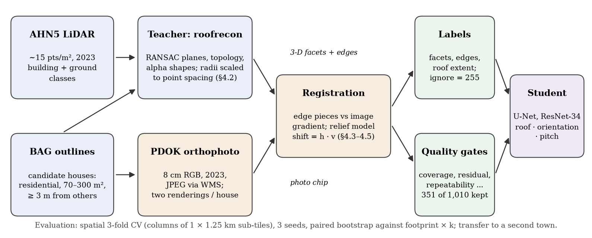

*Figure 1. Overview. The LiDAR teacher reconstructs each candidate roof; registration moves its
facets and edges onto the orthophoto; quality gates decide which houses become training data;
the student sees only the photograph.*

### 4.1 The teacher

`roofrecon` takes the building points inside a BAG outline and (i) segments planes with RANSAC
(threshold 0.12 m) followed by a connectivity check, (ii) builds facet adjacency and intersects
neighbouring planes to obtain ridges, hips and valleys, (iii) closes facet outlines from those
intersections where possible and falls back to an alpha shape otherwise, and (iv) types every
edge and reports areas and pitches. On synthetic roofs its facet areas are within 0.5% for
facets above 10 m² and 23% (median) below. Facets whose outline came from the alpha-shape
fallback, or that are under 10 m², are marked low-confidence.

### 4.2 Adapting the teacher to lower point density

The teacher's spatial radii were tuned on Delft (25–50 pts/m²). In Bilthoven (~15 pts/m²) only
63 of the first 1,010 houses passed the quality gates. The median share of roof points assigned
to a plane was 0.53, and the roof area implied by the BAG outline exceeded the reconstructed
roof area by a median of 94%, because most roof planes had been discarded. Every failing house we
inspected was covered by a single flight strip, with 4–7 cm scatter about the fitted plane, which
rules out strip misalignment. The cause was the fixed 0.3 m connectivity radius. At this density
the distance from a point to its fourth-nearest neighbour is about 0.29 m, so the connectivity
test split planes into fragments that were then discarded as too small.

Let $\delta_4$ be the median fourth-nearest-neighbour distance of a house's points. We scale
every spacing-dependent radius $\rho_j$ (connectivity, adjacency, line band, alpha radius, touch
radius) by

$$
\sigma = \begin{cases} 1 & \delta_4 \le 0.22\ \text{m} \\ \dfrac{1.8\,\delta_4}{0.3\ \text{m}} & \delta_4 > 0.22\ \text{m,} \end{cases}
\qquad \rho_j \leftarrow \sigma\,\rho_j .
$$

In a sweep over 1.4, 1.6, 1.8, 2.1 and 2.5 on 60 houses, 1.8 gave the lowest median footprint
check error (3.5%) and the most houses passing all teacher checks (21 of 60); 1.6 and 2.1 were
within 0.4 points. On a disjoint set of 60 houses, plane coverage rose to 0.957 and the footprint
check error fell to 3.9%. Up to 0.22 m spacing the original settings apply unchanged, and a
regression test confirms that the four Delft reports, the sparsest at 0.216 m, are reproduced
exactly.

The rule has a deliberate step at 0.22 m: just below it the connectivity radius is 0.3 m, about
1.36 δ₄; just above, 1.8 δ₄. It keeps the validated settings across the whole density range
they were validated on. The step falls in a gap in the data: point spacing is bimodal, with
houses in flight-strip overlaps at 0.17–0.22 m and the rest mostly at 0.28–0.32 m, and only 12
of 1,528 candidate houses lie between 0.22 and 0.25 m. The continuous alternative,
radius = max(0.3 m, 1.8 δ₄), differs only for δ₄ in (0.167, 0.22] m. Re-running the teacher with
it on all 258 houses in that range raises their median plane coverage from 0.918 to 0.938. For the
66 of them that were kept, the LiDAR roof area changes by a median of 1.6% (90th percentile
4.2%). §7.7 shows the effect of that change on the results.

### 4.3 The misalignment is relief displacement

On the four Delft development houses, LiDAR roof outlines sit 0.45–1.0 m (6–12 px) from the roofs
in the orthophoto; over the kept Bilthoven houses the registered shift is 0.21–0.82 m
(10th–90th percentile, median 0.46 m). Two explanations
predict this: a georeferencing error in the photo, or relief displacement. An orthophoto is
rectified to a terrain model, so a point at height $h$ above the ground, at horizontal distance
$r$ from the camera nadir, is displaced radially by

$$
d = \frac{h\,r}{H},
$$

where $H$ is the flying height [19] (Figure 2a). The two explanations differ at ground level:
a georeferencing error moves ground features too; relief displacement does not.

We tested this on four Delft houses. We rasterised the intensity of LiDAR ground points at 8 cm
(road markings, kerbs and paving are visible), computed edge maps of both rasters, and searched
for the shift maximising their normalised cross-correlation. Ground features were in place
within 0.2 m on all four houses, while the roof edges of the same houses needed 0.45–1.0 m
(Figure 2c). In a 5 m block bootstrap [20] comparing "no shift" with "the roof's shift" at
ground level, no shift won 98–100% of the resamples. Over all Bilthoven houses the fitted shifts
form radial patterns around several centres (Figure 2b), as expected for a mosaic of frames, each
with its own nadir. An earlier reading of the Delft shifts as a flight-strip effect was withdrawn
on this evidence.

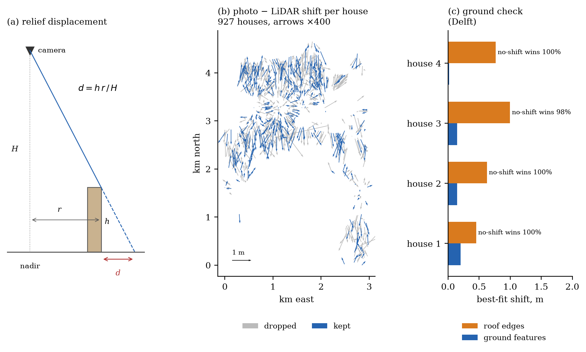

*Figure 2. (a) Relief displacement: a roof edge at height h appears displaced away from the
nadir by d = hr/H. (b) Constant shift (photo minus LiDAR) per Bilthoven house, arrows ×400; blue
houses were kept. The radial structure around frame nadirs is clearest north of the centre.
(c) Best-fit shift of ground features and of roof edges for four Delft houses; bootstrap share
in which no shift beats the roof's shift at ground level.*

### 4.4 Per-house registration

Within one house, $r/H$ is nearly constant, so the displacement of a point at height $h$ above
the house's ground level is $h\,\mathbf{v}$ for a single vector $\mathbf{v}$ (metres per metre).
We estimate it from the photograph.

Every LiDAR edge, shortened by 0.2 m at both ends, is cut into pieces of about 1 m. Piece $i$ has
unit normal $\mathbf{n}_i$, sample points $\mathbf{x}_{ik}$ and mean height $h_i$. With image
gradient $\nabla I$, its offset along the normal is

$$
t_i = \arg\max_{t \in [-T, T]} \ \frac{1}{K}\sum_{k=1}^{K} \left| \nabla I(\mathbf{x}_{ik} + t\,\mathbf{n}_i) \cdot \mathbf{n}_i \right| ,
$$

searched in 2 cm steps with parabolic refinement. Scoring the gradient component *across* the
piece, rather than its magnitude, suppresses tree texture and lines at other angles. A piece
only constrains motion along its normal (the aperture problem), so each contributes one linear
equation. We compared three shift models:

$$
\textbf{constant: } \mathbf{n}_i^\top \mathbf{s}_0 = t_i, \qquad
\textbf{pure relief: } \mathbf{n}_i^\top (h_i\,\mathbf{v}) = t_i, \qquad
\textbf{free relief: } \mathbf{n}_i^\top (\mathbf{s}_0 + h_i\,\mathbf{v}) = t_i .
$$

Each is solved by least squares with iterative rejection of pieces beyond three robust standard
deviations. The search runs twice: first with $T = 1.2$ m, then with $T = 0.4$ m around each
piece's prediction from the first fit, which stops pieces from locking onto gutters, chimneys
and roof trim (on one test house the residual fell from 0.34 to 0.11 m).

The free model is ill-conditioned on rectangular houses: the long axis is constrained only by a
few short edges, and extrapolating from roof heights of 3–8 m down to the ground produced
$\|\mathbf{s}_0\|$ up to 1.6 m. The ground test of §4.3 says $\mathbf{s}_0 = 0$, which gives the
pure relief model. On the 773 houses where both models repeat across renderings (§4.5), pure
relief has the lower residual on 511. The gain grows with height: for pieces more than 8 m above
ground, the rms residual is 0.195 m against 0.272 m for a constant shift (Figure 3c). Labels use
pure relief where it repeats and the constant shift otherwise. The median residual on kept
houses is 0.16 m (relief) and 0.19 m (constant), about two pixels.

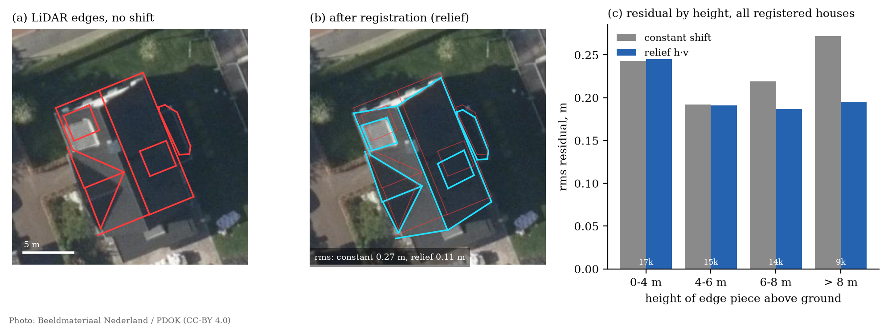

*Figure 3. (a) LiDAR edges projected without correction. (b) The same edges after the pure
relief correction (cyan; the uncorrected position is shown faint red). Edges higher above the
ground move further. (c) Residual by height of the edge piece, pooled over all registered
Bilthoven houses (counts in thousands of pieces).*

### 4.5 Registration depends on the JPEG rendering

PDOK serves the orthophoto only as JPEG, encoded per request. Two requests for the same 8 cm grid
differ by about 2 grey levels on average, concentrated at edges. On one house that was enough to
move the constant shift by 0.1 m and double its residual. Gaussian noise of the same amplitude
moved it far less: JPEG artefacts are concentrated exactly where registration measures.

We therefore request a second rendering with the bounding box offset by 7 × 5 pixels, so that
the 8 × 8 DCT blocks fall on different pixels, and register on both. Labels use the mean of the
two fits. A house is kept only if the two constant shifts agree within 0.15 m. On kept houses the
median disagreement is 0.024 m.

### 4.6 Label rasters

Each house becomes a 512 × 512 chip (40.96 m) on the photograph's own pixel grid, so the image is
never resampled. The label file has three bands (Figure 4):

| band | content | ignored (255) |
|---|---|---|
| facets | facet index, mapped to an orientation class and a pitch at training time | neighbouring buildings (outline + 2 m), low-confidence facets |
| edges | ridge, hip, valley, eave, rake, break, perimeter; 3 px wide | as above, plus untyped edges |
| roof extent | 1 on every facet of the house, including low-confidence ones | neighbouring buildings only |

Low-confidence facets make up a quarter of all roof area. Their outlines are often wrong
(slivers, overlaps, polygons spilling past the eaves), so their shape and orientation are
ignored. That they are roof is not in doubt, and band 3 says so; §7.2 shows why this
distinction matters.

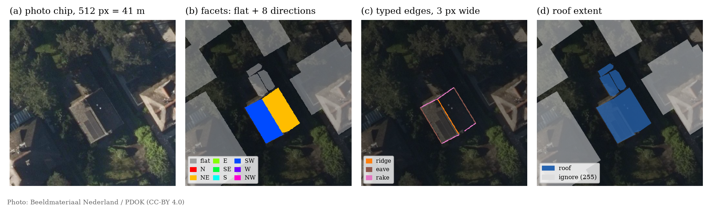

*Figure 4. One training example. (a) Orthophoto chip. (b) Facet band rendered as orientation
classes; neighbouring buildings and low-confidence facets are ignored (light). (c) Typed edges.
(d) Roof extent; only neighbours are ignored.*

### 4.7 Quality gates

A house enters the dataset only if it passes all of the following. The thresholds were set from
the Delft houses and the teacher's error table before any model was trained.

| gate | threshold | houses failing only this gate |
|---|---|---|
| unlabelled building points inside the walls | ≤ 5% | 90 |
| area in small or traced facets | ≤ 50% | 50 |
| registration residual (best model) | ≤ 0.25 m | 47 |
| plane coverage | ≥ 0.90 | 37 |
| roof area vs footprint consistency | within 10% | 32 |
| shift repeats across renderings | ≤ 0.15 m | 27 |

Of 1,010 Bilthoven candidates, 351 were kept (83,100 m² of roof, 3,015 facets); 60 more were too
large for a chip and 10 failed in the teacher (Figure 5a). An earlier version dropped every
house with more than a quarter of its roof area in uncertain facets, which excluded mainly complex
roofs. Raising that limit to half, and masking the uncertain facets instead, kept 105 more houses. In the median kept
house, 13% of the roof area is in ignored facets.

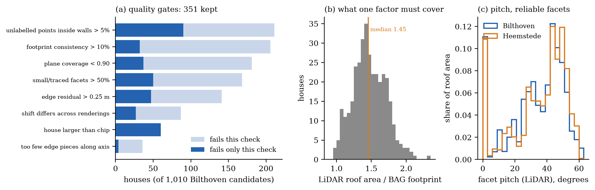

*Figure 5. (a) Quality gates on the 1,010 Bilthoven candidates: houses failing each gate (light)
and failing only that gate (dark). (b) Ratio of LiDAR roof area to BAG footprint on kept houses:
the spread a single factor cannot capture. (c) Area-weighted distribution of facet pitch in the
two towns.*

---

## 5. Model

### 5.1 Architecture and outputs

The student is a U-Net [1] with a ResNet-34 encoder [2] pretrained on ImageNet [3]
(`segmentation-models-pytorch` [4]). It takes an RGB chip $x \in \mathbb{R}^{3 \times 512 \times 512}$
and produces 12 channels per pixel:

- **roof extent**, one logit $\ell^{\text{roof}}$, for "this pixel is roof of the house";
- **orientation**, 10 logits: background, flat (pitch < 5°), and the eight compass octants of
  the downhill direction;
- **pitch**, one regression output $\hat\theta$ in degrees.

### 5.2 Losses

Let $\Omega_r$ be pixels with a roof-extent label, $\Omega_o$ pixels with an orientation label,
and $\Omega_\theta$ pixels on reliable facets with known pitch. The training loss, with the smooth L1 loss of [27] for pitch, is

$$
\mathcal{L} = \underbrace{\frac{1}{|\Omega_r|}\sum_{\Omega_r}\mathrm{BCE}(\ell^{\text{roof}}, y^{\text{roof}})}_{\mathcal{L}_{\text{roof}}}
\;+\; \lambda_o\,\mathcal{L}_{\text{orient}}
\;+\; \underbrace{\frac{1}{|\Omega_\theta|}\sum_{\Omega_\theta}\mathrm{SmoothL1}\!\left(\frac{\hat\theta}{45^\circ}, \frac{\theta}{45^\circ}\right)}_{\mathcal{L}_{\text{pitch}}} .
$$

We use two variants of the orientation term. In the *image* variant (the area models of §7.1),
$\mathcal{L}_{\text{orient}}$ is 10-way cross-entropy over all of $\Omega_o$, background
included, with $\lambda_o = 1$. In the *roof* variant (the orientation models of §7.3), it is
9-way cross-entropy over roof pixels only, among the flat and eight octant classes, with
$\lambda_o = 0.25$. Section 7.3 explains why both exist.

### 5.3 Orientation-equivariant augmentation

Rotating or flipping the image changes which way each roof faces, so the orientation labels must
be remapped along with the pixels. With octants numbered $o \in \{0,\dots,7\}$ clockwise from
north, and rows running south and columns east as in the image array, a 90° counter-clockwise
array rotation maps $o \mapsto o - 2$, a left-right flip $o \mapsto -o$, and an up-down flip
$o \mapsto 4 - o$ (all mod 8). We apply a random element of the dihedral group of order 8 to
every training chip. The remapping is unit-tested against synthetic height fields for every
direction and every transform.

### 5.4 Training

AdamW [25], learning rate 3 × 10⁻⁴ with cosine decay [26], weight decay 10⁻⁴, batch size 8,
40 epochs, checkpoint at the lowest validation loss. One run takes 30–55 minutes on an Apple M4
GPU (MPS). Training curves are in Appendix C.

### 5.5 From pixels to roof area

The house's roof is the union of connected components of $\{\sigma(\ell^{\text{roof}}) > 0.5\}$
that intersect its BAG outline buffered by 1.5 m (room for the lean). Its surface area is

$$
\hat A = \sum_{p \in \text{roof}} \frac{a_{\text{px}}}{\cos \hat\theta_p}, \qquad a_{\text{px}} = 0.08^2\ \text{m}^2 ,
$$

with $\hat\theta_p$ clipped to [0°, 70°]. We average $\hat A$ over the three seeds of a fold
(a small deep ensemble [30]) and multiply by a calibration factor, described in §6.

---

## 6. Evaluation protocol

**Spatial cross-validation.** The nine Bilthoven sub-tiles are grouped by grid column into three
folds: west (sub-tiles 03, 08, 13; 134 houses), centre (04, 09; 141) and east (05, 10, 15, 20;
76). Each fold's models train on the other two columns, with one sub-tile held out for validation.
Every reported Bilthoven number is out-of-fold: each house is predicted by models that never saw
its 1–3 km² neighbourhood.

**Reference method.** Footprint × $k$, with $k$ the median roof-to-footprint ratio on the same
training houses as the model (about 1.45). A per-construction-era factor scored 10.7% against
11.4% in leave-one-sub-tile-out and was not worth the extra parameters; the footprint alone
scores 31.2%. Leave-one-sub-tile-out also showed that sub-tiles 10, 15 and 20, three of the four in the east
fold, are the three easiest (8.0–9.4%), so any single held-out area can flatter a method.

**Calibration.** Fold $F$'s area factor is

$$
c_F = \operatorname{median}_{j \notin F}\ \frac{A_j^{\text{LiDAR}}}{\hat A_j},
$$

taken over the out-of-fold predictions of the *other two* folds (210–275 houses). No house
contributes to its own correction. This puts both methods on the same footing: the reference has
one fitted scalar, $k$, estimated on the fold's training houses, and the model gets one fitted
scalar, $c_F$, estimated on the same houses. A median bias near zero after calibration is
therefore partly by construction and is not evidence of accuracy. The evidence that the factor
generalises is that the three factors, each fitted without the fold's own houses, agree: 1.05,
1.08 and 1.05.

**Metrics and statistics.** The primary metric is the median absolute percentage error of roof
surface area against the LiDAR measurement. For model-versus-reference comparisons we report the
difference in median absolute error with a 95% paired bootstrap interval [21] over houses
(5,000 resamples), and an exact two-sided sign test on per-house wins (the number of houses on
which the model's absolute error is smaller, against Binomial(n, ½)). We use the two-sided test
throughout, although the hypothesis that the model is better was stated in advance, so that the
reported values are the conservative ones; the one-sided values are half as large. Both the
bootstrap and the sign test treat houses as independent. Neighbouring houses are not (they share
builders, eras and imaging conditions), so §7.7 repeats every comparison while resampling spatial
blocks and counting wins per sub-tile. We also report the 90th
percentile, the share of houses within 10%, and the median signed error (bias). The *clean*
subset contains the 159 houses with at most 10% of their roof in ignored facets, where the LiDAR
truth is most reliable.

---

## 7. Results

### 7.1 Roof area in Bilthoven

| | photo model | footprint × k |
|---|---|---|
| median \|error\|, 351 houses | **8.94%** | 11.48% |
| 90th percentile | **21.8%** | 27.7% |
| within 10% | 53% | 47% |
| median bias | +0.4% | +0.3% |
| west / centre / east | **8.6 / 10.5 / 8.6%** | 12.3 / 11.7 / 8.9% |
| clean houses (159) | **8.18%** | 13.48% |

*Table 1. Roof surface area, out-of-fold, three seeds per fold, cross-fold calibration. Medians are
given to two decimals because the differences quoted in the text are computed from unrounded
values (8.94 − 11.48 = −2.54, reported as −2.5).*

The model's median error is 2.5 points lower (95% CI −4.1 to −0.3), it is closer on 204 of 351
houses (two-sided sign test p = 0.0027), and it is ahead in each of the three held-out areas,
narrowly in the east, where the footprint factor fits best. On the clean houses the gap widens
to 5.3 points (−7.3 to −1.5).

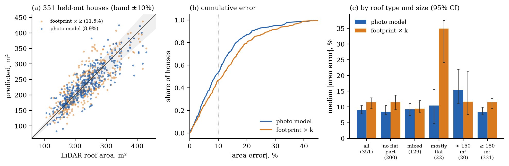

*Figure 6. (a) Predicted against LiDAR roof area for both methods; the grey band is ±10%.
(b) Cumulative distribution of absolute error. (c) Median error by roof type (flat share of the
labelled roof) and size, with 95% bootstrap intervals.*

Figure 6c shows where the gain comes from. We call a roof *mostly flat* when more than half of
its labelled area is flat (pitch < 5°); only 22 houses qualify, so the interval is wide. On these
roofs the footprint factor
overestimates by about a third (34.9% error), because $k$ encodes the slope of a typical pitched
roof; the photograph shows the roof is flat, and the model's error is 10.4%. On roofs with no flat
part the model still leads (8.5% vs 11.5%). On the 129 mixed roofs (5–50% flat) the two are level
(9.2% vs 9.5%). On the 20 roofs smaller than 150 m², it is worse
(15.3% vs 11.6%): small roofs are more often partly hidden by trees, and a missed section is a
larger share of a small total.

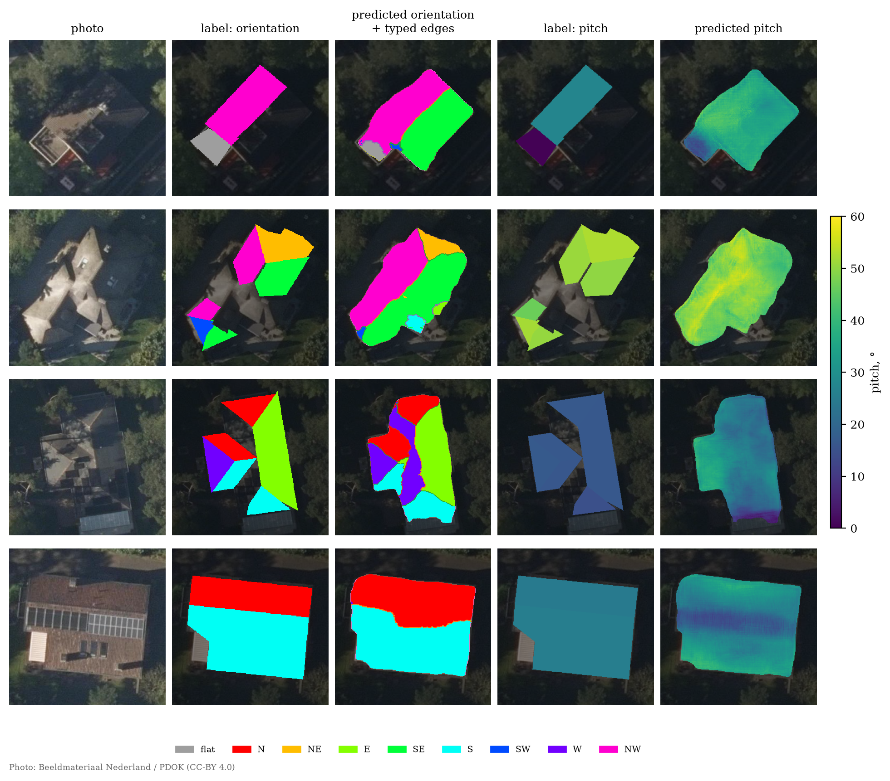

*Figure 7. Held-out Bilthoven houses (one or two per fold). Columns: photograph; LiDAR orientation
label; predicted orientation inside the predicted roof, with rule-typed edges; LiDAR pitch;
predicted pitch. Roof left unlabelled in the label columns is in low-confidence facets, which the
model still segments (rows 1–2). Row 3 is a typical failure: on a complex hipped roof, adjacent
facets are confused. In row 4, predicted pitch dips along the ridge, where the two slopes meet.*

### 7.2 What mattered for area

**The roof-extent band.** Our first model had no separate roof output; extent was read from the
orientation classes, which ignore low-confidence facets. On the east split it underestimated
area by 6.5% and lost to the reference (11.1% vs 8.5%), and it was worst on houses with many
ignored facets (18.3% vs 12.1%). The predictions showed the mechanism: dark or shadowed roof
sections had been labelled *ignore*, so the model received no signal that they were roof and
learned to leave them out. Adding band 3 and the roof output raised roof IoU from 0.79 to 0.84
and brought the same split to 7.7%. Ignoring an uncertain label is not neutral when the
uncertainty is correlated with appearance.

**Ensembling and calibration.** Single seeds pooled over all houses score 9.4%, 9.8% and 10.0%;
within a fold, seeds differ by 0.5–1.0 points. The uncalibrated three-seed ensemble scores 9.2%
with a bias of −5.5%, and its advantage over the reference is not significant (−2.3, CI −4.2 to
+0.1; 186/351, p = 0.29). Cross-fold calibration removes the bias and makes the difference
significant. We first tried calibrating each fold on its own validation sub-tile (24–30 houses).
The factors came out at 1.10–1.12, larger than the true underestimate, and flipped the bias to
+3.8%; we rejected that scheme in favour of the cross-fold one, which uses about ten times as
many houses.

**Alternative area estimators.** Replacing predicted pitch with the median training pitch on every
sloped pixel scored 11.1%; choosing a footprint factor from the predicted flat share scored
11.5%. Per-pixel pitch carries information beyond the roof's outline.

### 7.3 Facing direction

The seed-0 area models (image-variant orientation loss) were right on only 18–39% of labelled
roof pixels in their test areas (east 18%, west 32%, centre 39%), and on only 33–58% of their
*training* houses, with large
differences between compass directions. That pointed at optimisation, not generalisation.

Two features of the loss explained it. First, the orientation cross-entropy ran over the whole
chip, about 85% of which is background that the roof output already handles, so the roof-pixel
gradient was diluted. Second, the checkpoint was selected on a validation loss in which
roof-pixel orientation barely registered, so whatever orientation quality a run happened to have
at the selected epoch was partly luck. Restricting the loss to roof pixels made orientation
better and stable, but at weight 1.0 it dominated the shared network:

| west fold, mean of 3 seeds (range) | area models | roof loss, λ = 1 | roof loss, λ = 0.25 |
|---|---|---|---|
| orientation accuracy, test | 45% (32–54%) | 58% (49–64%) | **64% (61–67%)** |
| roof IoU | **0.84** | 0.57 | 0.80 |
| median area error | **9.8%** | 26.5% | 11.8% |
| pitch error, median per house | **8.5°** | 13.8° | 9.9° |

*Table 2. Orientation loss ablation, all three seeds of the west fold (the seed-0 model is the
32% quoted above). A 9-way choice contributes about 1.0 to the loss against
0.1–0.2 for the roof term.*

Even at λ = 0.25 one network trades orientation against area. We therefore keep the area models
for extent, pitch and area, and train separate orientation models (roof loss, λ = 0.25,
rotations), used inside the area models' roof mask. Across all nine orientation runs, single-model
accuracy on held-out roof pixels is 61–69% (fold means 64–65%). Averaging the three seeds of each
fold gives 70.8% over all 8.2 million labelled roof pixels (Figure 8). Of sloped pixels, 76% have
the exact octant, 7% are 45° off, 12% are 90° off, 1% are 135° off and 4% are reversed. The 90° errors
are concentrated on adjacent facets of hipped roofs.

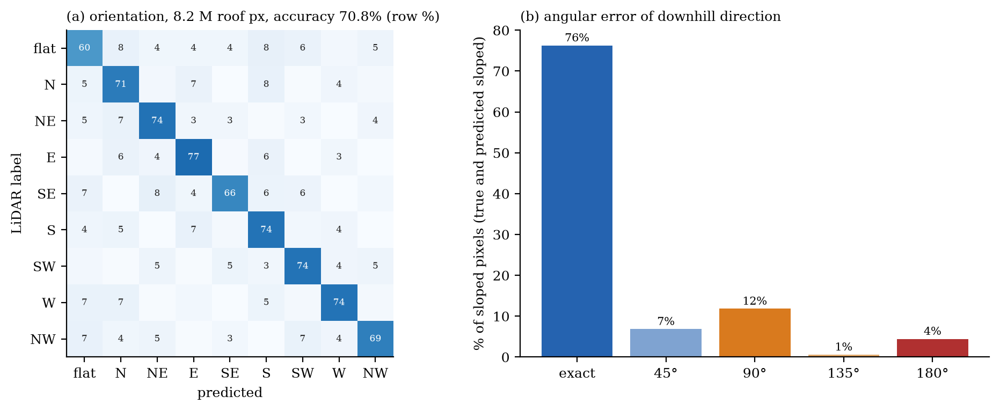

*Figure 8. (a) Orientation confusion matrix (row-normalised, %) of the three-model orientation
ensembles on all 351 held-out Bilthoven houses. (b) Angular error of the predicted downhill
direction on sloped pixels.*

**A withdrawn hypothesis.** Before the loss change we suspected sun shading. Slopes facing the sun
are bright, so rotating a training image keeps the shading but changes the label, and rotation
augmentation might scramble the strongest cue. A single run supported it: colour-only
augmentation raised test orientation from 32% to 49%. The two other seeds of the rotation setting,
however, reached 54% and 49%. The seed alone moved orientation by about 20 points. With three
seeds per setting and the corrected loss, rotations beat colour-only augmentation on every
measure (orientation 64% vs 60%, area 11.8% vs 14.7%). The hypothesis was an artefact of seed
variance and an under-weighted loss.

### 7.4 Edge types

We derive edges geometrically. Facets are connected regions of one predicted orientation class,
with fragments under about 1 m² merged into a neighbour. Each boundary between two sloped facets
is a ridge if both fall away from it and their downhill directions differ by at least 135°, a hip
if both fall away at a smaller angle, a valley if both fall towards it, and a break for a step
in the same direction. Boundaries against the outside are an eave, a rake or a perimeter,
depending on the local outward normal relative to the slope. A predicted edge pixel counts as
correct if a labelled edge of the same type lies within 3 px (24 cm); precision is the share of
predicted edge pixels that are correct. Recall is the share of labelled edge pixels that have a
predicted edge of the same type within 3 px. To separate errors in the
rules from errors in the predictions, an *oracle* applies the same rules to the LiDAR
orientation labels.

| edge type | model precision / recall | oracle precision / recall |
|---|---|---|
| any | 0.53 / 0.43 | 0.99 / 0.77 |
| ridge | 0.50 / 0.34 | 0.96 / 0.74 |
| eave | 0.50 / 0.43 | 0.94 / 0.85 |
| rake | 0.46 / 0.27 | 0.84 / 0.81 |
| hip | 0.24 / 0.30 | 0.98 / 0.62 |
| valley | 0.07 / 0.03 | 0.91 / 0.40 |
| break | 0.03 / 0.04 | 0.45 / 0.18 |

*Table 3. Typed edges, all 351 held-out houses.*

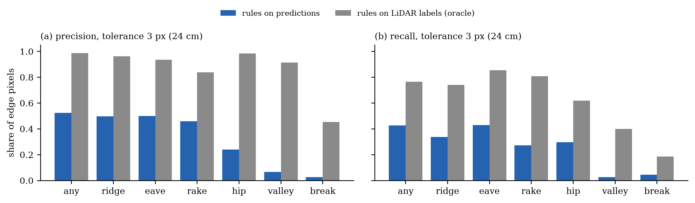

*Figure 9. Precision and recall per edge type for the rules applied to predictions and to the
LiDAR labels (oracle).*

The rules are sound (oracle precision 0.84–0.98 for every type except break); the predicted
orientation and outline are the bottleneck. "Break" exposes a gap in the rules themselves: in the
labels it is mostly a change of pitch between parts facing the same way, which orientation
classes cannot represent.

We tried three ways to improve on the rules, all on the west fold:

| variant | any-type precision / recall | outcome |
|---|---|---|
| rules (reference) | 0.51 / 0.42 | |
| straighten facets: polygonise, snap to house axes | 0.53 / 0.40 | exact on synthetic shapes; on real predictions it mostly fell back to plain simplification |
| learned edge-type head (8-way) | 0.66 / 0.20 | predicts only eaves and ridges; rare types never beat "no edge" |
| learned edge location, typed by the nearest rule edge | 0.38 / 0.75 at p > 0.5; 0.48 / 0.43 at p > 0.7 | finds many more edges, better for hips and valleys, worse for ridges and eaves; thinning to 1 px did not restore precision |

*Table 4. Edge variants (west fold).*

Choosing a threshold or a per-type combination from these numbers would tune on test houses, so
the reported system stays rule-based.

### 7.5 Pitch per facet

We take the mean predicted pitch over each reliable facet's *true* outline, so that this measures
pitch and not segmentation, and compare it with the LiDAR pitch, area-weighted. In Bilthoven, out
of fold, the error is 8.5° against 13.4° for the best constant (38.6°), with a bias of −1.4°.
Predictions regress towards typical values (Figure 10a): a weighted linear fit of predicted on
true pitch has slope 0.50; flat roofs read 15.6° on average, and roofs steeper than 50° read
41.4°. A near-vertical photograph does not determine pitch geometrically. The model can only infer
it from shading, texture and context, and under that uncertainty it hedges towards the mean.


### 7.6 Transfer to a second town

Heemstede/Aerdenhout lies about 50 km west of Bilthoven, among coastal dune villages. It was
chosen from six candidates because its LiDAR and photographs are from the same year as
Bilthoven's, so only the place changes. Data construction ran with identical settings and kept
147 of 529 candidates (28%, against 35% in Bilthoven), with the same registration behaviour
(median shift 0.50 m; pure relief better on 63% of houses, against 66%).

**Without retraining.** All nine Bilthoven area models (three folds × three seeds) were averaged and
calibrated with the factor from Bilthoven's out-of-fold predictions (1.059). The reference used
Bilthoven's $k$ (1.454).

| | Heemstede (147) | Bilthoven (351) |
|---|---|---|
| model median area error | 11.8% | 8.9% |
| footprint × k | 14.0% | 11.5% |
| model − reference (95% CI); wins, sign test | −2.2 (−5.3 to +1.2); 76/147, p = 0.74 | −2.5 (−4.1 to −0.3); 204/351, p = 0.0027 |
| model median bias | **−10.7%** | +0.4% |
| roof IoU | 0.837 | 0.82–0.84 |
| orientation accuracy (ensemble) | 71% | 71% |
| typed edges, any: precision / recall | 0.57 / 0.41 | 0.53 / 0.43 |
| pitch per facet: error / bias | **12.2° / −8.5°** | 8.5° / −1.4° |

*Table 5. Bilthoven models applied to Heemstede, nothing re-tuned.*

What the model reads directly from the image (extent, orientation and edges) transfers to
Heemstede without loss. Area does not: the model underestimates by 10.7%, and its advantage over the
reference is no longer significant. The cause is pitch (Figure 10b). Heemstede's roofs are
somewhat steeper (area-weighted median 41.5° against 38.6°), but that does not explain it. For
facets whose true pitch is 40–50° (mean 45.5° in both towns), the model reads 38.9° in Bilthoven
and 31.8° in Heemstede, and the offset is similar in every pitch band. A uniform offset between
equally steep roofs is a difference in appearance, not in geometry. Shading depends on sun
elevation and roofing material, and is the most plausible carrier of pitch in a vertical
photograph. We did not have per-frame acquisition times to test this directly.

**Training on both towns.** We retrained with Heemstede's houses added, one model per fold (seed 0),
pairing each Bilthoven column with a block of Heemstede sub-tiles (west: Bilthoven 03, 08, 13 with
Heemstede 01, 06; centre: 04, 09 with 02, 07; east: 05, 10, 15, 20 with 13). Every test house is
still in an area its model never saw. Each two-town model is compared with the Bilthoven-only
seed-0 model of the same fold on the same houses, both calibrated as in §6.

| | Heemstede (147) | Bilthoven (351) |
|---|---|---|
| two-town model | **8.0%** | **8.1%** |
| Bilthoven-only model, seed 0 | 11.0% | 8.5% |
| footprint × k (each model's training houses) | 13.9% | 11.2% |
| two-town − reference (95% CI); wins, sign test | −5.9 (−8.5 to −2.9); 94/147, p = 0.0009 | −3.1 (−4.8 to −1.6); 207/351, p = 0.0009 |
| two-town − Bilthoven-only (95% CI); wins, sign test | −3.0 (−5.2 to −0.5); 84/147, p = 0.10 | −0.4 (−1.6 to +0.6); 179/351, p = 0.75 |
| bias before calibration, two-town / Bilthoven-only | −6.0% / −17.4% | −4.3% / −6.3% |
| pitch per facet: error / bias (Heemstede) | 8.8° / −2.7° | |
| same, Bilthoven-only seed 0 | 13.1° / −8.9° | |

*Table 6. Training on both towns.*

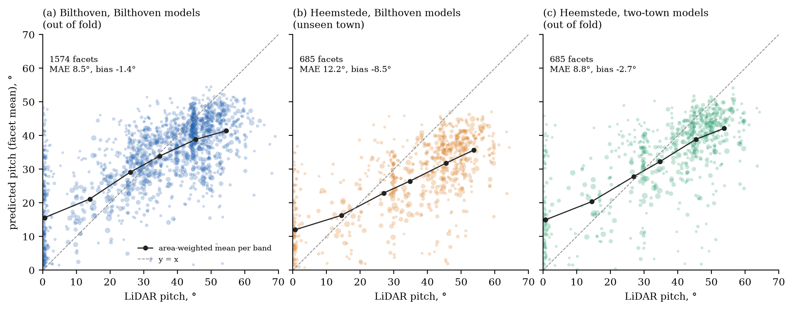

*Figure 10. Predicted against LiDAR pitch per reliable facet (marker size ∝ facet area); black:
area-weighted mean per band of true pitch. (a) Bilthoven, out of fold. (b) Heemstede with
Bilthoven models: the whole curve drops by about 7°. (c) Heemstede with two-town models, out of
fold: the offset is gone and the curve matches Bilthoven's.*

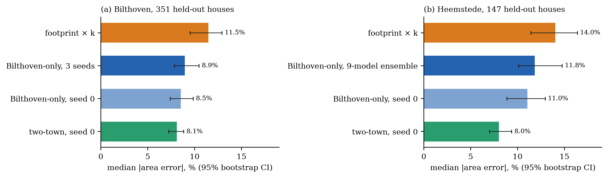

*Figure 11. Median area error with 95% bootstrap intervals for every configuration, per town.*

The pitch offset closes: 40–50° roofs read 38.9° in Heemstede, the same as in Bilthoven, and the
home town loses nothing (8.1% against 8.5%). This experiment does *not* show that two towns are
enough to generalise to a third. After it, Heemstede is no longer an unseen town; what it shows
is that a modest amount of local training data removes the gap. The evidence for the
area gain over the Bilthoven-only model in Heemstede is moderate, not conclusive: the bootstrap
interval of the difference in median error excludes zero (−5.2 to −0.5), but the two-town model is
closer on only 84 of 147 houses (two-sided sign test p = 0.10). The two measures ask different
questions. The bootstrap concerns the median error, which improves because the large
underestimates disappear; the sign test counts houses, many of which were already well measured.
The pitch result is the clearer one (8.8° against 13.1° per facet, with the bias falling from
−8.9° to −2.7°). The two-town models are single seeds; the 3.0-point gain is several times the
0.5–1.0 point seed spread measured in §7.2, but a second and third seed would settle it. §7.7
shows that this comparison is also the one most sensitive to the teacher's settings.

### 7.7 Robustness: spatial dependence and teacher settings

**Spatial dependence.** The intervals above resample houses, which assumes their errors are
independent. To test how much that matters, we repeat every model-versus-reference comparison
twice more. The first resamples 250 m × 250 m blocks (houses assigned by footprint centroid;
56–102 blocks per comparison). The second resamples whole 1 × 1.25 km sub-tiles (9 in Bilthoven,
5 in Heemstede). With so few sub-tiles the percentile bootstrap is unreliable and tends to be too
narrow, since every replicate mixes the same few tiles. At that scale we therefore also report
the number of sub-tiles on which the model's median error is lower, with an exact two-sided sign
test over sub-tiles. With five sub-tiles that test cannot go below p = 0.0625.

| comparison | difference | houses | 250 m blocks | sub-tiles won (p) | sub-tiles, bootstrap |
|---|---|---|---|---|---|
| Table 1: Bilthoven | −2.54 | −4.1 to −0.3 | −3.8 to −0.3 | 8/9 (0.04) | −3.5 to −0.7 |
| Table 1: Bilthoven, clean | −5.30 | −7.3 to −1.5 | −7.2 to −1.7 | 9/9 (0.0039) | −7.2 to −2.4 |
| Table 5: Heemstede, untrained | −2.17 | −5.3 to 1.2 | −5.0 to 1.3 | 5/5 (0.06) | −4.7 to −0.1 |
| Table 5: Heemstede, untrained, clean | −8.93 | −12.1 to −1.8 | −12.4 to −2.4 | 5/5 (0.06) | −12.9 to −3.4 |
| Table 6: Heemstede, two-town vs reference | −5.88 | −8.5 to −2.9 | −7.7 to −2.9 | 4/5 (0.38) | −7.5 to −2.0 |
| Table 6: Heemstede, two-town vs Bilthoven-only | −3.03 | −5.2 to −0.5 | −5.0 to −0.5 | 5/5 (0.06) | −4.4 to −1.2 |
| Table 6: Bilthoven, two-town vs reference | −3.08 | −4.8 to −1.6 | −4.7 to −1.5 | 7/9 (0.18) | −5.5 to −1.0 |
| Table 6: Bilthoven, two-town vs Bilthoven-only | −0.41 | −1.6 to 0.6 | −1.5 to 0.7 | 5/9 (1.00) | −1.8 to 0.8 |

*Table 7. Difference in median absolute area error (model minus comparison, percentage points)
with 95% intervals from resampling houses, 250 m blocks and sub-tiles
(`scripts/block_bootstrap.py`).*

Every interval that excluded zero when resampling houses still excludes it when resampling 250 m
blocks, and the two borderline upper bounds are unchanged (Table 1: −3.8 to −0.3;
Heemstede two-town vs Bilthoven-only: −5.0 to −0.5). The Bilthoven result also holds
at sub-tile level: the model is better on 8/9 sub-tiles (p = 0.04). In Heemstede,
five sub-tiles are too few for a sub-tile-level test to reach significance, although the
two-town model wins on all five against the Bilthoven-only model.

**Teacher settings.** §4.2 showed that a continuous version of the spacing rule would change the
LiDAR roof area of 66 kept houses by a median of 1.6%. Table 8 re-scores the existing models
against that alternative truth. Only the truth changes; the models are not retrained.

| comparison | houses with changed truth | as used: difference (95% CI) | continuous rule: difference (95% CI) |
|---|---|---|---|
| Table 1: Bilthoven | 50 | −2.5 (−4.1 to −0.3) | −2.5 (−4.1 to −0.1) |
| Table 5: Heemstede, untrained | 16 | −2.2 (−5.3 to 1.2) | −2.1 (−4.5 to 1.4) |
| Table 6: Heemstede, two-town vs reference | 16 | −5.9 (−8.5 to −2.9) | −5.7 (−8.1 to −2.7) |
| Table 6: Heemstede, two-town vs Bilthoven-only | 16 | −3.0 (−5.2 to −0.5) | −2.7 (−5.1 to 0.2) |
| Table 6: Bilthoven, two-town vs reference | 50 | −3.1 (−4.8 to −1.6) | −3.3 (−5.1 to −1.6) |
| Table 6: Bilthoven, two-town vs Bilthoven-only | 50 | −0.4 (−1.6 to 0.6) | −0.4 (−1.6 to 0.6) |

*Table 8. Model-versus-comparison differences with the LiDAR truth as used and as the continuous
spacing rule would give it (`scripts/sigma_sensitivity.py`).*

All conclusions stand except one. The two-town gain over the Bilthoven-only model in Heemstede
moves from −5.2 to −0.5 to −5.1 to 0.2, so its interval crosses zero. Together with the
sign test above, this makes the area part of that result suggestive rather than established. The
pitch part (§7.6) does not depend on it.

---

## 8. Discussion

**What the photograph carries.** Extent, facing direction and the positions of roof edges are
visible in a vertical photograph and are learned in a way that transferred between our two towns. Pitch is
not directly visible. The model infers it from cues that depend on imaging conditions, and
regresses it towards the training distribution. Since surface area scales with 1/cos θ,
reading a 45° roof as 38° lowers its area by about 10%, close to the −10.7% bias seen in
Heemstede, so area inherits pitch's fragility. Flat roofs are the
exception that makes the method worthwhile: the photograph shows flatness clearly, and that is
where a footprint factor fails worst.

**The teacher sets the ceiling.** All errors are measured against `roofrecon`. Some of the
model's "losses" on houses with many uncertain facets are disagreements with a truth that is
itself approximate; consistent with this, the model's lead grows as the truth gets cleaner
(Table 1, clean subset). The quality gates trade quantity for label fidelity (351 of 1,010
houses). How that trade-off affects the student was not explored beyond the choice of ignore
masks over house-level rejection.

**Ignore is not neutral.** The first model's failure (§7.2) generalises. When label uncertainty
correlates with appearance (dark, shaded or cluttered roof sections), masking the uncertain
labels removes exactly the examples that would teach the model to handle that appearance. Splitting
the label into a confident part ("this is roof") and an uncertain part ("this is its shape")
kept the signal that was trustworthy.

**Seeds before stories.** Three conclusions in this project came from single training runs and
were later withdrawn: the sun-shading hypothesis (§7.3), an apparent 2-point "training noise"
that actually compared different training sets, and the claim that learned edge bands were too
thick. In each case the effect was smaller than the seed-to-seed spread. Comparisons between
training recipes need several seeds per arm [31]; we adopted three as the minimum.

**Oracles locate bottlenecks.** Applying the edge rules to true orientation (§7.4) showed in one
evaluation that the rules were not the problem, which saved a round of work on the rules.

---

## 9. Limitations

- **Two towns, both Dutch, both 2023 imagery.** Transfer to a third town never trained on, to a
  different photo year, and to building stock outside the Netherlands is untested. A test on
  Vught (AHN5 and photographs from 2024) was prepared and not run.
- **The truth is a pipeline,** not a survey. Its small-facet error (23% median below 10 m²) and
  traced outlines remain in the labels; gates and ignore masks reduce their effect but do not
  remove it. No independent ground truth was available. The LiDAR project defines a protocol for
  hand measurements (`validation/PROTOCOL.md`), but it was never carried out and its measurement
  table is empty, so every error in this paper is relative to the teacher.
- **Building outlines are an input.** The area estimator uses the BAG outline to select the house,
  and the reference needs one to exist. Outside the Netherlands OpenStreetMap is the likely
  substitute, with uneven coverage.
- **Dataset size.** 351 kept houses in Bilthoven and 147 in Heemstede is small. The quality gates keep about a third
  of candidates, and more sheets would increase the data roughly linearly.
- **Edges.** Valleys and breaks are close to unusable; breaks need pitch-aware typing.
- **Single seeds** for the two-town models.

---

## 10. Conclusion

A LiDAR roof pipeline can supervise a photo-only roof model without manual labels, provided three
mismatches between the two modalities are handled: relief displacement, encoding-dependent
registration, and the teacher's sensitivity to point density. Trained on 351 automatically
labelled houses, a standard U-Net measures roof surface area from 8 cm orthophotos with a median
error of 8.9% against LiDAR, ahead of the footprint-factor method, and far ahead of it on flat
roofs. The part of roof geometry that the photograph shows directly transferred to a second town. Pitch
does not, and with it area, until the new town is represented in training. For regions without
LiDAR, the practical implication is that a small local labelled sample is likely to be worth
more than further model refinement. The open test is whether a model trained on several towns
transfers to a town it has never seen.

---

## Reproducibility

All code is public under the MIT licence (URLs above); data are public and are downloaded by the
scripts. Hardware: Apple
M4, 16 GB, PyTorch with MPS. Every number in this paper is read from files under `outputs/`
written by the scripts below, and every figure is drawn from those files by
`scripts/paper_figures.py`.

```sh
uv sync && uv run pytest                                   # 71 tests
uv run python scripts/download_ahn.py --sheet 32CN1
uv run python scripts/crop_sheet.py --sheet data/raw/ahn5/2023_C_32CN1.LAZ \
    --subtiles 03 04 05 08 09 10 13 15 20
uv run python scripts/stage2_build_dataset.py --tile data/raw/ahn5/32CN1_04.LAZ   # per sub-tile
uv run python scripts/stage2_summary.py 32CN1_03 32CN1_04 ...
uv run python scripts/stage3_baseline.py
uv run python scripts/stage4_train.py --run cv_west_s1 --seed 1 --orient-loss image \
    --test 32CN1_03 32CN1_08 32CN1_13 --val 32CN1_10                        # x 3 folds x 3 seeds
uv run python scripts/stage4_evaluate.py --run cv_west_s1
uv run python scripts/stage4_cv_summary.py cv_west,cv_west_s1,cv_west_s2 cv_centre,... cv_east,...
uv run python scripts/stage4_train.py --run s5w_west_geom_s0 --orient-weight 0.25 \
    --test 32CN1_03 32CN1_08 32CN1_13 --val 32CN1_10                        # orientation models
uv run python scripts/stage5_edges.py
uv run python scripts/pitch_per_facet.py
uv run python scripts/new_town_eval.py --name heemstede 25CN1_01 25CN1_02 25CN1_06 25CN1_07 25CN1_13
# two-town models, one per fold (west shown; centre: test 04 09 + 25CN1_02 07, val 13;
# east: test 05 10 15 20 + 25CN1_13, val 13), scored per town
uv run python scripts/stage4_train.py --run bt_west --orient-loss image \
    --extra-tiles 25CN1_01 25CN1_02 25CN1_06 25CN1_07 25CN1_13 \
    --test 32CN1_03 32CN1_08 32CN1_13 25CN1_01 25CN1_06 --val 32CN1_10
uv run python scripts/stage4_evaluate.py --run bt_west --tiles 32CN1_03 32CN1_08 32CN1_13 --tag bilt
uv run python scripts/stage4_evaluate.py --run bt_west --tiles 25CN1_01 25CN1_06 --tag heem
uv run python scripts/stage4_evaluate.py --run cv_west --tiles 25CN1_01 25CN1_06 --tag heem
uv run python scripts/two_town_compare.py
# robustness (§7.7) and figures
uv run python scripts/block_bootstrap.py
uv run python scripts/sigma_sensitivity.py
uv run python scripts/paper_figures.py && uv run python scripts/paper_figures.py --numbers
```

Per-stage reports with every intermediate result are in `docs/stage1_report.md` to
`docs/stage4_report.md`, `docs/stage5_notes.md` and `docs/second_town_report.md`.

## Data and acknowledgements

AHN point clouds © Rijkswaterstaat / Het Waterschapshuis, CC0. BAG © Kadaster, CC0. Aerial
photographs © Beeldmateriaal Nederland, served by PDOK, CC-BY 4.0. No house identifiers or
addresses appear in this paper or its figures.

---

## References

[1] O. Ronneberger, P. Fischer, T. Brox. U-Net: Convolutional networks for biomedical image segmentation. *MICCAI*, 2015.

[2] K. He, X. Zhang, S. Ren, J. Sun. Deep residual learning for image recognition. *CVPR*, 2016.

[3] J. Deng, W. Dong, R. Socher, L.-J. Li, K. Li, L. Fei-Fei. ImageNet: A large-scale hierarchical image database. *CVPR*, 2009.

[4] P. Iakubovskii. Segmentation Models PyTorch. GitHub repository, 2019.

[5] M. A. Fischler, R. C. Bolles. Random sample consensus: A paradigm for model fitting with applications to image analysis and automated cartography. *Communications of the ACM* 24(6), 1981.

[6] R. Schnabel, R. Wahl, R. Klein. Efficient RANSAC for point-cloud shape detection. *Computer Graphics Forum* 26(2), 2007.

[7] H. Edelsbrunner, D. G. Kirkpatrick, R. Seidel. On the shape of a set of points in the plane. *IEEE Transactions on Information Theory* 29(4), 1983.

[8] V. Verma, R. Kumar, S. Hsu. 3D building detection and modeling from aerial LIDAR data. *CVPR*, 2006.

[9] E. Maggiori, Y. Tarabalka, G. Charpiat, P. Alliez. Can semantic labeling methods generalize to any city? The Inria aerial image labeling benchmark. *IGARSS*, 2017.

[10] A. Van Etten, D. Lindenbaum, T. M. Bacastow. SpaceNet: A remote sensing dataset and challenge series. arXiv:1807.01232, 2018.

[11] V. Mnih. *Machine Learning for Aerial Image Labeling.* PhD thesis, University of Toronto, 2013.

[12] S. Lee, S. Iyengar, M. Feng, P. Shenoy, S. Maji. DeepRoof: A data-driven approach for solar potential estimation using rooftop imagery. *KDD*, 2019.

[13] N. Nauata, Y. Furukawa. Vectorizing world buildings: Planar graph reconstruction by primitive detection and relationship inference. *ECCV*, 2020.

[14] F. Zhang, N. Nauata, Y. Furukawa. Conv-MPN: Convolutional message passing neural network for structured outdoor architecture reconstruction. *CVPR*, 2020.

[15] J. Chen, Y. Qian, Y. Furukawa. HEAT: Holistic edge attention transformer for structured reconstruction. *CVPR*, 2022.

[16] S. Srivastava, M. Volpi, D. Tuia. Joint height estimation and semantic labeling of monocular aerial images with CNNs. *IGARSS*, 2017.

[17] L. Mou, X. X. Zhu. IM2HEIGHT: Height estimation from single monocular imagery via fully residual convolutional-deconvolutional network. arXiv:1802.10249, 2018.

[18] G. Christie, R. R. R. M. Abujder, K. Foster, S. Hagstrom, G. D. Hager, M. Z. Brown. Learning geocentric object pose in oblique monocular images. *CVPR*, 2020.

[19] P. R. Wolf, B. A. Dewitt, B. E. Wilkinson. *Elements of Photogrammetry with Applications in GIS*, 4th ed. McGraw-Hill, 2014.

[20] H. R. Künsch. The jackknife and the bootstrap for general stationary observations. *Annals of Statistics* 17(3), 1989.

[21] B. Efron, R. J. Tibshirani. *An Introduction to the Bootstrap.* Chapman & Hall, 1993.

[22] D. R. Roberts et al. Cross-validation strategies for data with temporal, spatial, hierarchical, or phylogenetic structure. *Ecography* 40(8), 2017.

[23] P. Ploton et al. Spatial validation reveals poor predictive performance of large-scale ecological mapping models. *Nature Communications* 11, 2020.

[24] B. Frénay, M. Verleysen. Classification in the presence of label noise: A survey. *IEEE Transactions on Neural Networks and Learning Systems* 25(5), 2014.

[25] I. Loshchilov, F. Hutter. Decoupled weight decay regularization. *ICLR*, 2019.

[26] I. Loshchilov, F. Hutter. SGDR: Stochastic gradient descent with warm restarts. *ICLR*, 2017.

[27] R. Girshick. Fast R-CNN. *ICCV*, 2015.

[28] D.-H. Lee. Pseudo-label: The simple and efficient semi-supervised learning method for deep neural networks. *ICML Workshop on Challenges in Representation Learning*, 2013.

[29] P. Kaiser, J. D. Wegner, A. Lucchi, M. Jaggi, T. Hofmann, K. Schindler. Learning aerial image segmentation from online maps. *IEEE Transactions on Geoscience and Remote Sensing* 55(11), 2017.

[30] B. Lakshminarayanan, A. Pritzel, C. Blundell. Simple and scalable predictive uncertainty estimation using deep ensembles. *NeurIPS*, 2017.

[31] X. Bouthillier et al. Accounting for variance in machine learning benchmarks. *MLSys*, 2021.

---

## Appendix A. Settings

| component | setting |
|---|---|
| teacher | RANSAC threshold 0.12 m; min facet 1 m²; radii × σ (§4.2), σ = 1.77 on a typical Bilthoven house |
| registration | pieces ~1 m, ends trimmed 0.2 m; search ±1.2 m then ±0.4 m, step 2 cm; outliers > 3 robust SD |
| renderings | two per house, second offset 7 × 5 px; agreement ≤ 0.15 m |
| chip | 512 × 512 px, 8 cm, photo's native grid |
| ignore | neighbours' outlines + 2 m; facets < 10 m² or with traced outlines (orientation, pitch, edges only) |
| flat threshold | pitch < 5° (reliable facets: 542 under 2°, then a gap to ~10°) |
| network | U-Net, ResNet-34, ImageNet weights, 12 output channels |
| optimiser | AdamW, lr 3 × 10⁻⁴, cosine decay, weight decay 10⁻⁴, batch 8, 40 epochs |
| augmentation | dihedral group D4 with octant remapping |
| area models | image-variant orientation loss, λ_o = 1; 3 seeds per fold |
| orientation models | roof-variant orientation loss, λ_o = 0.25; 3 seeds per fold |
| roof selection | components of p > 0.5 touching BAG outline + 1.5 m |
| pitch clip | [0°, 70°] |
| edge tolerance | 3 px (24 cm); min facet for edge derivation 150 px (~1 m²) |
| statistics | paired bootstrap, 5,000 resamples; exact two-sided sign test |

## Appendix B. Negative results and withdrawn conclusions

| belief or attempt | what happened |
|---|---|
| the Delft shifts come from east–west flight strips | withdrawn: 1,000 houses show radial patterns around frame nadirs |
| a 4-parameter relief model per house | ill-conditioned; replaced by pure relief once the ground test fixed s₀ = 0 |
| the teacher's settings transfer between densities | they do not; a 0.3 m connectivity radius fragments planes at 15 pts/m² |
| dropping houses with more than a quarter of their roof uncertain keeps labels clean | excluded mainly complex roofs; raising the limit to half and masking uncertain facets kept 105 more houses |
| ignoring uncertain facets is enough | the model learned to omit uncertain roof; extent needed its own label |
| calibrating on one validation sub-tile | over-corrected (+3.8% bias); replaced by cross-fold calibration |
| "training noise is about 2 points" | withdrawn: seeds vary 0.5–1 point; the 2 points compared different training sets |
| rotation augmentation scrambles the sun-shading cue | withdrawn: seed alone moved orientation by 20 points; with 3 seeds, rotations won on every measure |
| roof-only orientation loss at full weight | orientation improved, area error tripled |
| straightening predicted facets | exact on synthetic shapes, no gain on real predictions |
| learned edge-type head | collapses to eaves and ridges |
| learned edge bands were too thick | withdrawn: thinning to 1 px raised precision by only 2–8 points |
| Heemstede's area error comes from steeper roofs | only in part; the main cause is a 7° town-wide pitch offset |

## Appendix C. Training curves

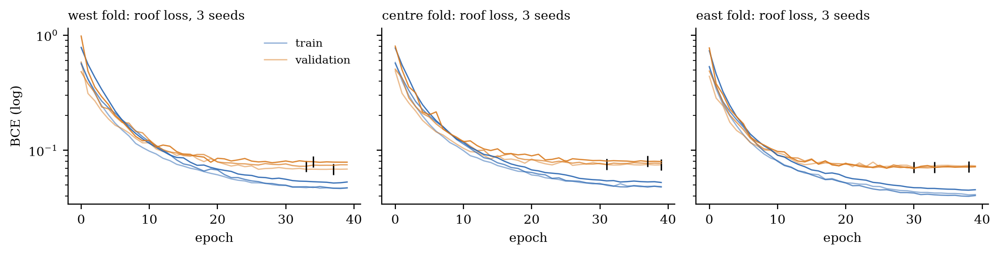

*Figure 12. Roof-extent loss of the nine area models (three seeds per fold), training (blue)
and validation (orange), log scale; ticks mark the selected checkpoint. Validation loss flattens
after about 25 epochs without rising, so the selected epoch varies between seeds with little
effect on the loss.*
